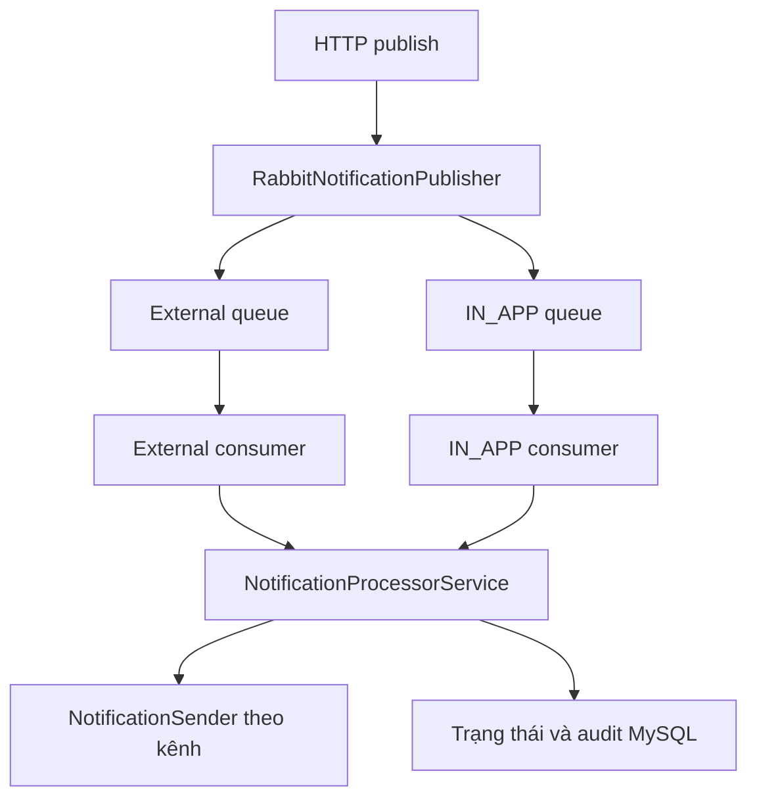

# Kiến trúc và luồng xử lý

Spring MVC nhận yêu cầu HTTP. RabbitMQ tách việc nhận yêu cầu khỏi việc gửi. MySQL lưu cấu hình, trạng thái và audit. Điểm khởi động là `NotificationserviceApplication`, bật scheduling, Spring Retry và serialization phân trang dạng DTO.

| Package dưới `com.project.notificationservice` | Trách nhiệm |
| --- | --- |
| `controller`, `dto`, `exception` | Hợp đồng HTTP/SSE, validation, DTO và lỗi HTTP |
| `publisher`, `consumer`, `config` | Publish/split, Rabbit listener và cấu hình broker, executor, scheduler, Thymeleaf |
| `service`, `service.impl`, `sender` | Nghiệp vụ, đổi trạng thái, lựa chọn và gọi sender |
| `entity`, `enums`, `repository`, `specification` | Dữ liệu, trạng thái, query JPA và bộ lọc dead-letter |
| `scheduler`, `helper`, `properties` | Retry định kỳ, SSE heartbeat, audit và cấu hình typed |

## Từ publish đến gửi

| Nhánh | Exchange | Routing key | Queue |
| --- | --- | --- | --- |
| External | `notification.external.exchange` | `notification.external.routing.key` | `notification.external.queue` |
| IN_APP | `notification.inapp.exchange` | `notification.inapp.routing.key` | `notification.inapp.queue` |
| Dead-letter | `notification.dlq.exchange` | `notification.dlq.routing.key` | `notification.dlq.queue` |

`RabbitMQConfig` khai báo direct exchange, durable queue, JSON converter và dead-letter binding dùng chung cho hai queue nhận. `dispatch` tách IN_APP khỏi EMAIL, SMS và PUSH. Bản gọi trực tiếp `publish` gửi nguyên event vào external queue. Consumer IN_APP luôn xử lý kênh IN_APP. Theo cấu hình mặc định, listener IN_APP có 2–5 consumer.

1. Consumer kiểm tra tùy chọn kênh, mặc định bật nếu chưa có bản ghi. Kênh bị tắt được bỏ qua. Consumer tiếp tục áp dụng rate limit trước khi giao cho processor. Nếu chạm rate limit, consumer ghi log và bỏ qua kênh.
2. `RateLimitingServiceImpl` kiểm tra ba khóa theo thứ tự: recipient + channel + event type, recipient + channel + source, recipient + channel. Các chiều còn lại dùng enum `GLOBAL`. Mỗi khóa dùng cửa sổ đếm và khoảng cách tối thiểu giữa hai lần gửi theo `app.rate-limit`. Tra cứu dùng pessimistic write lock và giao dịch `READ_COMMITTED`. Spring Retry áp dụng cho `CannotAcquireLockException`.
3. Processor kiểm tra trùng cho thông báo mới bằng `(eventId, channel)`, tra sender và kiểm tra contact. Database cũng bảo vệ khóa duy nhất ở bước lưu. Bản ghi đã có ID bỏ qua bước kiểm tra trùng, bao gồm retry và thông báo lên lịch. Cùng `eventId` có thể dùng cho các kênh khác nhau. Hai người nhận cùng kênh cần event ID riêng.
4. Processor ghi `PROCESSING` trước khi gọi sender, sau đó ghi trạng thái kết quả. `NotificationStatusServiceImpl` sở hữu thao tác persist trạng thái. `NotificationLogHelper` ghi audit bằng transaction `REQUIRES_NEW`.

| Kênh | Contact từ `Recipient` | Hành vi sender |
| --- | --- | --- |
| EMAIL | `email` | Render subject/body từ template đang active theo `eventType + channel`, dùng payload làm biến Thymeleaf, gửi HTML qua JavaMailSender |
| IN_APP | `userId` | Phát SSE event `notification`. Kết nối lưu theo recipient trong bộ nhớ tiến trình. Khi offline, lịch sử vẫn đọc từ database |
| SMS | `phone` | Ghi log mô phỏng |
| PUSH | `deviceToken` | Ghi log mô phỏng |

External consumer gọi `sendExternal` qua Spring proxy với `@Async("notificationExecutor")`. Exception phát sinh sau khi giao task sang worker thường nằm ngoài lời gọi listener. IN_APP chạy đồng bộ trong consumer. Scheduler gọi thẳng processor, qua đường xử lý không chạy lại hai bước kiểm tra preference và rate limit của consumer. Trong `process`, method này gọi trực tiếp `sendExternal` hoặc `sendInApp` trên cùng instance, nên đường external từ scheduler hiện chạy đồng bộ.

## Lên lịch, retry và replay

| Hành động | Đường xử lý | Kết quả |
| --- | --- | --- |
| Admin tạo draft và lên lịch | `AdminNotificationServiceImpl` → `Notification.scheduleAt` | Chỉ `DRAFT` hoặc `PENDING` được lên/cập nhật lịch. Giá trị `scheduledAt` cũng đặt `nextRetryTime`, trạng thái thành `PENDING` |
| Scheduler lấy bản ghi tới hạn | `NotificationRetryScheduler` → repository → processor | Quét mỗi 10 giây mặc định. Chọn `PENDING` có `nextRetryTime < now` và `retryCount < app.retry.max-retries`. Ghi `RETRYING`, rồi processor ghi `PROCESSING` |
| Sender ném exception | `NotificationStatusServiceImpl` → `Notification.incrementRetryAndCalculateNextTime` | Tăng bộ đếm. Nếu còn lượt, đặt lại `PENDING` và hẹn theo `baseDelaySeconds × 2^(retryCount - 1)`. Đạt ngưỡng của bản ghi thì chuyển `FAILED` và xóa lịch retry. Mặc định ba lần thất bại, khoảng đợi 60 và 120 giây trước lần tiếp theo |
| Admin retry `FAILED` | `AdminNotificationServiceImpl.retry` | Reset thành `PENDING`, xóa lỗi, đặt `retryCount = 0` và `nextRetryTime = now`. Scheduler xử lý lại bản ghi cũ |
| Broker dead-letter | `DeadLetterConsumer` → `DeadLetterServiceImpl` | Lưu payload gốc và thông tin từ phần tử `x-death` đầu tiên vào `dead_letter_events`. Lỗi lưu được ghi log trong service |
| Admin replay event | `AdminNotificationServiceImpl.replay` | Tìm event chưa resolved theo ID và queueName, deserialize và kiểm tra event, gọi `publish(event)` vào **external exchange**, rồi đặt `resolved = true` |

External consumer dùng `AmqpRejectAndDontRequeueException` cho lỗi thoát ra khỏi khối xử lý một kênh. Khi đó vòng lặp dừng và broker có thể chuyển event gốc sang DLQ. Lỗi sender do processor bắt đi theo đường retry trong MySQL. `queueName` của API replay hiện dùng để lọc bản ghi, kể cả với event vốn đến từ IN_APP.

## Dữ liệu và điểm cần giữ khi sửa

| Bảng | Vai trò |
| --- | --- |
| `notifications` | Trạng thái, lịch gửi/retry, payload JSON, lịch sử và trạng thái đọc. Unique `(event_id, channel)` |
| `notification_logs` | Chuyển trạng thái và mô tả audit. FK tới notification |
| `notification_templates` | Template DB theo `(template_code, channel)` |
| `notification_preferences` | Tùy chọn theo `(recipient_id, channel)` |
| `rate_limit_records` | Bộ đếm và thời điểm gửi. Unique theo recipient, channel, source và event type |
| `dead_letter_events` | Payload thô, lý do broker ghi nhận, trạng thái resolved |

- Flyway quản lý schema. `V1__init_schema.sql` tạo bảng, `V2__insert_sample_data.sql` thêm dữ liệu mẫu. Tắt Flyway placeholder replacement để giữ biểu thức Thymeleaf. UUID map sang kiểu chuỗi ở MySQL.
- `recipient_contact` là `NOT NULL` trong schema và `updatable = false` trong entity. Processor gọi nhánh lưu `FAILED` khi thiếu contact, nên constraint có thể khiến insert thất bại. API sửa bản ghi `FAILED` hiện áp dụng payload và errorMessage nếu được cung cấp.
- SSE hiện lưu một emitter trên mỗi recipient trong một tiến trình. Subscribe mới thay emitter cũ. Heartbeat `ping` mặc định mỗi 15 giây. Client đọc lịch sử qua HTTP để đồng bộ khi kết nối lại.
- Các endpoint hiện phục vụ demo với ID người dùng do client cung cấp. Chi tiết phạm vi xác thực nằm ở [hợp đồng HTTP](api.md).
